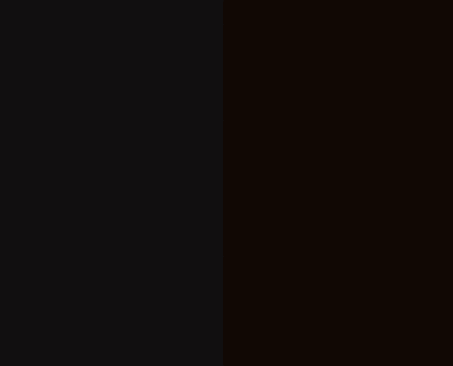

# Crapless

A crapless craps table you can open on your phone and play with friends: join by link, take a seat, pass the dice. Play money only. Nothing is sold and nothing can be won.


Two phones at one table, played by a script against the real server: Ana invites, Bo joins, and each takes a turn with the dice. The dice are fixed for the recording; in play the server rolls them. Re-recorded by `npm run demo:gif --prefix web`.



**Pedantic mode**, for a player who wants to bet less than 8 on the 3: switch it on, the whole table is told, and Place bets on 2, 3, 11 and 12 can start at 4. Re-recorded on its own by `npm run demo:gif --prefix web -- pedantic`.

**Play it:** https://crapless.onrender.com. The first visit after a quiet spell can take about a minute while the server wakes, and the table starts over.

**Status:** v1 is built: up to eight players share a table by link. [Case study](docs/case-study.md) · [runbook](docs/runbook.md) · [stats](https://crapless.onrender.com/stats). Design: [docs/spec.md](docs/spec.md), [docs/protocol.md](docs/protocol.md) and [docs/adr/](docs/adr/).

## Development
Needs [uv](https://docs.astral.sh/uv/) and Node 22.

Build the page, then run the server and open http://localhost:8000:

```bash
npm ci --prefix web && npm run build --prefix web
```

```bash
uv run uvicorn crapless.server.app:create_app --factory --port 8000
```

While working on the page, `npm run dev --prefix web` reloads it and passes `/ws` to that server.

Tests:

```bash
uv run pytest
```

```bash
npm test --prefix web
```

The browser test seats two players and gives each a turn with fixed dice. It needs a browser once:

```bash
cd web && npx playwright install chromium
```

```bash
npm run e2e --prefix web
```

The browser tests compare the screens each GIF shows with how they looked when it was recorded (`web/e2e/looks/`), and fail when they differ. To re-record both GIFs (needs Docker):

```bash
npm run demo:gif --prefix web
```
